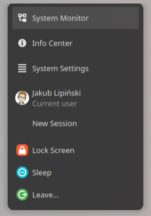
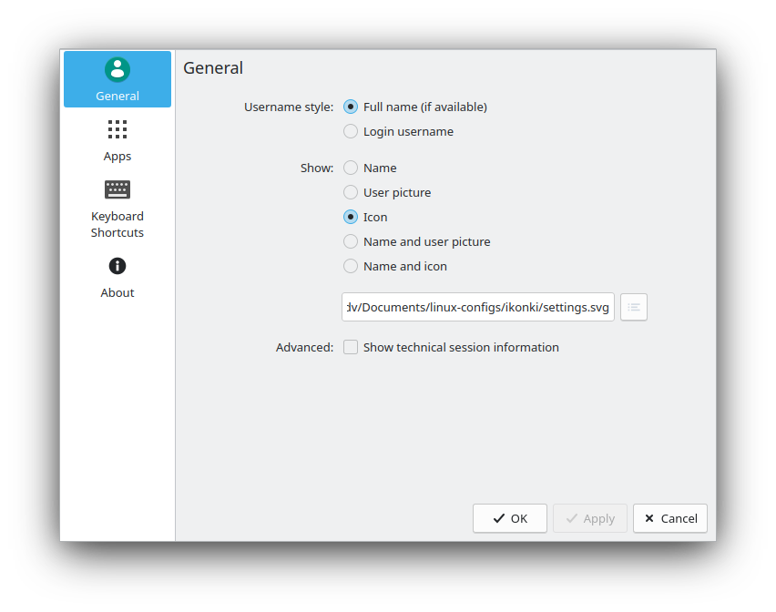

# USwitch
Modified version of User Switch plasmoid (GPL-2.0)
https://invent.kde.org/plasma/kdeplasma-addons/-/tree/master/applets/userswitcher

Adds configurable application shortcuts, lock/sleep/leave actions and a customisable panel icon.




## Requirements
- Plasma 6 (tested on 6.8), Qt ≥ 6.8, KDE Frameworks ≥ 6.14
- Build: CMake, extra-cmake-modules, KIO, KService, KJobWidgets development packages

## Build & install
The plasmoid ships with a small QML plugin (`com.dv.uswitcher.private`), so it must be built:

```sh
cmake -B build -DCMAKE_INSTALL_PREFIX=/usr
cmake --build build
sudo cmake --install build
```

Then restart Plasma (`systemctl --user restart plasma-plasmashell`).

Options: `-DPACKAGE_PLASMOID=ON` also creates a `.plasmoid` archive (QML files only, the plugin still has to be installed).

## Support
If you find this plasmoid useful, you can support its development on Ko-fi:

[](https://ko-fi.com/divinae4535)
